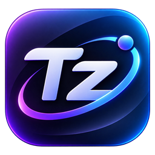

  

<h1 align="center">TzIsland</h1>

  A <b>Dynamic Island</b> do iPhone, agora no seu Windows. 
  Uma ilha elegante no topo da tela que mostra o que importa e se abre com animações suaves.

  <a href="https://github.com/th-alves/TzIsland/releases/latest"><b>⬇️ Baixar a versão mais recente</b></a>
  &nbsp;·&nbsp; Windows 10 e 11 (64 bits)

---

## ✨ O que é

O TzIsland fica discreto no topo da tela, mostrando a música tocando, o timer ou uma notificação.
Passe o mouse ou clique e ele se expande em um painel com tudo o que você usa no dia a dia,
sem abrir janelas nem tirar o foco do que você está fazendo.

## 🧩 Recursos

| | Módulo | O que faz |
|---|---|---|
| 🏠 | **Início** | Resumo do dia: clima, agenda, música e atalhos, com cards que você reorganiza |
| 🎵 | **Mídia** | Controla Spotify, YouTube e outros players, com capa e letra sincronizada |
| ⏱️ | **Foco** | Pomodoro e timer; durante o foco, as notificações esperam |
| 🌊 | **Ambientação** | Sons relaxantes: chuva, floresta, café, lareira, ondas… |
| ✉️ | **Inbox** | Notificações do Windows reunidas em um só lugar |
| ✏️ | **Produtividade** | Notas com formatação (negrito, listas, cores) e tarefas |
| 📋 | **Área de transferência** | Histórico do que você copiou |
| 🎚️ | **Mixer de volume** | Volume de cada aplicativo separadamente |
| 🖥️ | **Sistema** | Wi‑Fi, Bluetooth, brilho, microfone e a **bateria dos seus fones, mouse e teclado** |
| 📁 | **Arquivos** | Arquivos recentes e downloads à mão |
| 🤖 | **Agentes de IA** | Acompanha o que seus assistentes de IA estão fazendo |
| 🎙️ | **Ditado** e 📷 **Mirror** | Fale para digitar e veja sua câmera rapidinho |

Cada módulo pode ser ligado, desligado e reordenado em **Configurações → Módulos**.

## 💫 Detalhes que fazem diferença

- **Animações com física de mola**, fluidas como no iPhone
- **Some sozinho** em jogos, vídeos em tela cheia e capturas de tela
- **Atualiza sozinho**: quando sai uma versão nova, ele avisa e instala
- **Leve**: quase zero de CPU quando está parado
- Visual escuro e minimalista, em **português**

## 🚀 Como instalar

1. Baixe o **`TzIsland-win-Setup.exe`** na [página de versões](https://github.com/th-alves/TzIsland/releases/latest).
2. Abra o arquivo. Ele instala e já inicia a ilha no topo da tela.
3. Clique com o botão direito no ícone perto do relógio para abrir as **Configurações**.

> Prefere não instalar? Baixe o **`TzIsland-win-Portable.zip`**, extraia e rode o `TzIsland.exe`.
>
> Se o Windows mostrar "O Windows protegeu o computador", clique em **Mais informações → Executar assim mesmo**.

## ❓ Perguntas rápidas

**A bateria do meu fone não aparece.** Nem todo aparelho informa a bateria ao Windows. Se ela também não aparece em
*Configurações do Windows → Bluetooth e dispositivos*, o aparelho não envia essa informação.

**Como desinstalo?** Em *Configurações do Windows → Aplicativos*, procure **TzIsland** e clique em Desinstalar.

**Encontrei um problema ou tenho uma ideia.** Abra uma [issue](https://github.com/th-alves/TzIsland/issues). Toda sugestão é bem-vinda!

---

  Feito com 💜 por <b>Thigas</b> · C# · WPF · .NET 8 
  Quer compilar ou contribuir? Veja o <a href="docs/DESENVOLVIMENTO.md">guia de desenvolvimento</a>.

